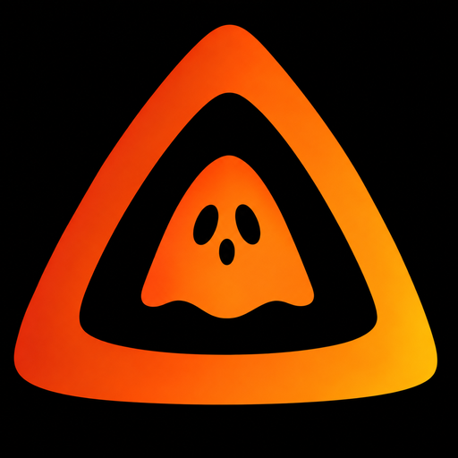

<p align="center">
  
</p>

<h1 align="center">GhostyFlix RPC</h1>

<p align="center">A small desktop companion that shares your Jellyfin playback on Discord.</p>

<p align="center">
  <a href="https://github.com/GhostyGang/ghostyflix-rpc/releases/latest"></a>
  <a href="https://github.com/GhostyGang/ghostyflix-rpc/actions/workflows/windows-release.yml"></a>
  <a href="LICENSE"></a>
</p>

GhostyFlix RPC connects to your Jellyfin account and publishes the current movie, episode, or track as a Discord Rich Presence activity. It runs on your computer and talks directly to Jellyfin, Discord desktop, and the artwork services you select.

[Download GhostyFlix](https://github.com/GhostyGang/ghostyflix-rpc/releases/latest) · [Setup guide](docs/USER_GUIDE.md) · [Release notes](CHANGELOG.md)

## What it includes

- Jellyfin Quick Connect or API key sign-in.
- Movie titles and years, episode details, and music track and artist information.
- Discord playback timestamps, an optional watched or listened percentage, and time remaining.
- Jellyfin, TMDB, or OMDb posters, plus optional MusicBrainz and Cover Art Archive album artwork.
- Playback filters for Jellyfin libraries and media types.
- A live preview in the app, paused playback, and a configurable play/pause badge.
- Adjustable playback polling, startup behavior, system tray controls, and checks for new releases.

Discord controls the native card design and its progress bar. GhostyFlix supplies activity text, timing, and artwork; it cannot change Discord's card layout.

## Start here

1. Download and open the current Windows executable from [Releases](https://github.com/GhostyGang/ghostyflix-rpc/releases/latest).
2. Enter your Jellyfin server address and choose **Quick Connect**.
3. Enter the one-time code under the Jellyfin user menu → **Quick Connect** on a signed-in device, then approve it.
4. Keep Discord desktop open on the same computer and allow activity sharing in Discord's privacy settings.
5. Start playback in Jellyfin. GhostyFlix shows a local preview and publishes the activity to Discord.

If the server does not offer Quick Connect, use the API key option in the app. The [user guide](docs/USER_GUIDE.md) covers sign-in, artwork sources, online updates, and troubleshooting.

## Artwork providers

Jellyfin artwork works without an extra key. TMDB and OMDb keys are optional and saved locally. Each provider may use a different title-matching method and has its own terms and request limits.

- [Create a TMDB API key](https://www.themoviedb.org/settings/api)
- [Get an OMDb API key](https://www.omdbapi.com/apikey.aspx)

For OMDb, enter the key or a complete request URL such as `https://www.omdbapi.com/?i=tt3896198&apikey=YOUR_KEY`. Music artwork can use Jellyfin images or MusicBrainz and the Cover Art Archive; no music API key is required.

GhostyFlix includes TMDB's approved logo and attribution in the artwork settings. This product uses the TMDB API but is not endorsed or certified by TMDB. See [TMDB's attribution requirements](https://www.themoviedb.org/about/logos-attribution).

## Updates

The app checks public GitHub Releases for a newer Windows build. It verifies the download with the release SHA-256 checksum, then closes and relaunches GhostyFlix while the installer replaces the running executable. Releases must be public for in-app update checks.

## Privacy

- Your server address and Jellyfin sign-in token, plus optional artwork keys, are saved in `%APPDATA%\GhostyFlix RPC\ghostyflix_rpc.ini`. This local file is **not encrypted**; do not share or commit it.
- Playback is read from Jellyfin and sent to Discord's local desktop client. Discord privacy settings control who can see your activity.
- Discord receives the selected poster image URL. If a Jellyfin address is only reachable on your home network, Discord may not be able to load its poster; a public artwork provider can be used instead.
- The play/pause badge image is requested from Placehold.co. The URL contains only the symbol and selected color.
- Diagnostic logs are stored beside the settings file. Redact personal details before sharing a log.

## Build from source

Use Windows, Python 3.12 or newer, and [uv](https://docs.astral.sh/uv/):

```powershell
uv sync --locked --extra gui --no-dev
uv run pyinstaller --noconfirm main.spec
```

The app build is written to `dist/GhostyFlix RPC.exe`. To launch the UI from source, run `uv run python -m ghostyflix_rpc`.

## Contributing

Focused bug reports and improvements are welcome. Please remove server addresses, usernames, tokens, Quick Connect codes, and provider keys from logs and screenshots before posting. See [CONTRIBUTING.md](CONTRIBUTING.md).

## License

GhostyFlix RPC is distributed under the [MIT License](LICENSE). Jellyfin, Discord, TMDB, OMDb, MusicBrainz, and the Cover Art Archive are independent services; their names, artwork, and usage terms remain their respective owners' responsibility.
